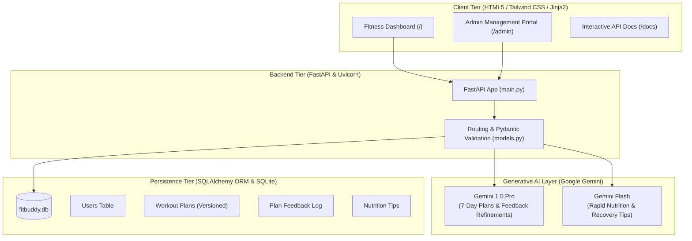

# 🏋️‍♂️ FitBuddy AI - Generative AI Fitness & Nutrition Platform

FitBuddy is an intelligent, web-based fitness planning platform built with **FastAPI**, **Google Gemini 1.5 Pro**, **Google Gemini Flash**, **SQLAlchemy ORM**, **SQLite**, and **Jinja2**. It delivers structured, personalized 7-day fitness routines, provides goal-specific nutrition and recovery guidance, and continuously refines workout plans based on direct user feedback.

---

## 🌟 System Architecture & AI Model Allocation



### 🧠 Model Specialization
1. **Google Gemini 1.5 Pro (`gemini-1.5-pro`)**:
   - **Role:** Heavy reasoning and deep contextual planning.
   - **Use Case:** Generates comprehensive 7-day workout plans (Scenario 1) and intelligently reconciles user feedback to update existing routines (Scenario 2).
2. **Google Gemini Flash (`gemini-1.5-flash`)**:
   - **Role:** High-speed, low-latency targeted generation.
   - **Use Case:** Delivers concise, goal-targeted nutrition and recovery tips with practical action steps (Scenario 3).

---

## 🚀 Key Modules & Capabilities

### 1. Personalized 7-Day Workout Plan Generator (Scenario 1)
- **Inputs:** Name, age, weight, weight unit (`kg`/`lbs`), primary fitness goal (*weight loss, muscle gain, general wellness, endurance, strength*), preferred workout intensity (*low, medium, high*), equipment access, and injury notes.
- **AI Processing:** Powered by **Gemini 1.5 Pro** with calibrated prompt engineering.
- **Structure:** Daily warm-up, target exercises with muscle group, sets, reps, rest intervals, coaching cues, and cool-down routines.
- **Persistence:** Stored in SQLite as active plan version 1 (`v1`).

### 2. Feedback-Based Workout Plan Updater (Scenario 2)
- **Inputs:** Existing plan ID and natural language feedback (e.g. *"more focus on cardio"*, *"include more rest days"*, *"shorten to 30 mins"*, *"lower back injury - avoid squats"*).
- **AI Processing:** **Gemini 1.5 Pro** evaluates previous plan data and adapts the schedule according to user feedback.
- **Versioning:** Increments version (`v2`, `v3`, etc.) in SQLite and records an audit log of feedback.

### 3. Fast Nutrition & Recovery Coach (Scenario 3)
- **Inputs:** Target goal and category (*nutrition* vs *recovery & sleep*).
- **AI Processing:** **Gemini Flash** generates concise, evidence-based recommendations with specific metrics and an immediate *"Today's Action Step"*.

### 4. Admin Management Dashboard (`/admin`)
- **Portal URL:** [http://127.0.0.1:8000/admin](http://127.0.0.1:8000/admin)
- **Features:**
  - Real-time statistics: Total Users, Total Plans Generated, Feedback Submissions, Tips Logged.
  - User Management Table with CRUD operations (inspect plans, delete profile).
  - Plan Inspection Modal with full day-by-day drill-down.
  - Feedback iteration audit log.

---

## 🔮 Future Enhancements & Upgrades (Implemented & Roadmap)

| Enhancement | Status | Description & Architecture |
|---|---|---|
| **AI Voice Assistant 🎙️** | **Live** | Web Speech API integration (`SpeechRecognition` + `speechSynthesis`). Users tap the microphone to ask fitness or nutrition questions and receive spoken AI responses. |
| **Wearable Device Integration ⌚** | **Live** | Sync simulated smartwatch telemetry (Apple Watch, Garmin, Fitbit: steps, calories burned, avg BPM) into SQLite biometrics table. |
| **Progress Tracking Dashboard 📊** | **Live** | Interactive **Chart.js** line & bar graphs displaying body weight trajectory, workout completion, and caloric burn. |
| **AI-Based Plan Adaptation 🤖** | **Live** | Evaluates user RPE (Rate of Perceived Exertion) and previous plan feedback to adapt volume, exercises, and intensity for progressive overload. |
| **Personalized Meal Planning 🍎** | **Live** | Endpoint `POST /api/meal-plan` generating structured breakfast, lunch, snack, and dinner protocols with macronutrient breakdowns. |
| **Exercise Demonstration 🏋️** | **Live** | Form cues, target muscle badges, and biomechanical technique checkpoints embedded in every exercise card. |
| **Workout Notifications 🔔** | **Live** | Browser Web Notifications API for hydration reminders and daily workout alarms. |
| **Mobile Application 📱** | **Roadmap** | Responsive PWA architecture ready for Capacitor / React Native / Flutter mobile wrapper. |
| **Multi-language Support 🌐** | **Live** | Language switcher supporting **English (en)** and **Tamil (தமிழ், ta)** across meal planning, voice coaching, and UI labels. |
| **Advanced AI Fitness Coach 🧠** | **Live** | Multi-turn conversational AI reasoning engine answering nutrition, recovery, and kinesiology queries via `/api/coach/ask`. |

---

## 📁 Project Directory Structure

```
hello.demo/
│
├── main.py               # FastAPI application with routes, Jinja2 rendering, and REST endpoints
├── database.py           # SQLAlchemy ORM models, SQLite engine, and unified CRUD helpers
├── models.py             # Pydantic data schemas for validation and API documentation
├── gemini_service.py     # Gemini 1.5 Pro & Flash AI engine with built-in smart fallback
├── app_server.py         # Zero-dependency Python server (runs out-of-the-box)
├── run.py                # Dual launcher (auto-detects FastAPI/Uvicorn or standalone mode)
├── test_fitbuddy.py      # Automated unit test suite (Scenario 1, 2, 3, ORM, Admin)
├── requirements.txt      # Project dependencies
├── .env.example          # Environment variables template
│
├── templates/
│   ├── index.html        # Client-facing interactive single-page application UI
│   └── admin.html        # Administrative dashboard and plan management portal
│
└── static/
    ├── css/
    │   └── style.css     # Styles, animations, active day states, and print layout
    └── js/
        └── app.js        # Frontend AJAX controllers, state management, and DOM renderers
```

---

## ⚙️ Setup & Deployment

### 1. Environment Configuration
Copy `.env.example` to `.env`:
```bash
cp .env.example .env
```
Configure your keys:
```env
GEMINI_API_KEY=your_gemini_api_key_here
GEMINI_WORKOUT_MODEL=gemini-1.5-pro
GEMINI_NUTRITION_MODEL=gemini-1.5-flash
DATABASE_URL=sqlite:///./fitbuddy.db
PORT=8000
```
> **Note:** If no Gemini API key is provided, FitBuddy automatically engages its **Built-in Smart Engine**, producing valid 7-day plans and targeted nutrition tips so you can develop and test offline.

### 2. Standard Launch (FastAPI & Uvicorn)
Install dependencies:
```bash
pip install -r requirements.txt
```
Start server:
```bash
uvicorn main:app --reload --port 8000
```

- 🌐 **Fitness App:** [http://127.0.0.1:8000](http://127.0.0.1:8000)
- 📊 **Admin Portal:** [http://127.0.0.1:8000/admin](http://127.0.0.1:8000/admin)
- 📚 **Swagger Docs:** [http://127.0.0.1:8000/docs](http://127.0.0.1:8000/docs)
- 📖 **ReDoc Docs:** [http://127.0.0.1:8000/redoc](http://127.0.0.1:8000/redoc)

### 3. Zero-Dependency Launch (Out-of-the-Box)
Run directly with Python's standard library:
```bash
python run.py
```

---

## 🧪 Automated Testing

Execute the comprehensive test suite:
```bash
python test_fitbuddy.py
```
Output:
```
....
----------------------------------------------------------------------
Ran 4 tests in 0.132s

OK
```

---

## 📡 API Endpoints Summary

| Method | Endpoint | Description | Model Used |
|---|---|---|---|
| `GET` | `/` | Web Fitness Dashboard | — |
| `GET` | `/admin` | Admin Management Dashboard | — |
| `POST` | `/api/generate-plan` | Scenario 1: Generate 7-Day Plan | `gemini-1.5-pro` |
| `POST` | `/api/regenerate-plan` | Scenario 2: Refine Plan with Feedback | `gemini-1.5-pro` |
| `POST` | `/api/nutrition-tip` | Scenario 3: Nutrition / Recovery Tip | `gemini-1.5-flash` |
| `GET` | `/api/users` | List all user profiles | — |
| `POST` | `/api/users` | Create user profile | — |
| `GET` | `/api/users/{id}` | Get user profile details | — |
| `DELETE`| `/api/users/{id}` | Delete user profile & plans | — |
| `GET` | `/api/plans/{id}` | Retrieve specific workout plan | — |
| `GET` | `/api/plans/user/{id}` | User's active plan & version history | — |
| `GET` | `/api/tips` | Query logged nutrition & recovery tips | — |
| `GET` | `/api/admin/stats` | System metrics & recent logs | — |
| `GET` | `/api/health` | Health check & model status | — |
